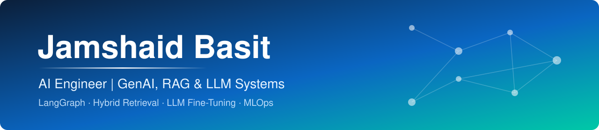

<div align="center">



<br/>

[](https://jamshaid-basit.netlify.app/)
[](https://www.linkedin.com/in/jamshaid-basit-227b35219/)
[](https://scholar.google.com/citations?user=K4hlEhQAAAAJ&hl=en)
[](https://www.researchgate.net/profile/Jamshaid-Basit)
[](mailto:jamshaidbasit0011@gmail.com)

</div>

---

## 👨‍💻 About Me

I'm an **AI Engineer with 3.5+ years of experience** building production-grade GenAI, RAG and agentic systems. I hold an **M.Sc. in Software Engineering (AI & ML) from NUST** and 4 industry certifications across AWS, Google Cloud, Databricks and Microsoft.

```yaml
role:        AI Engineer, GenAI / RAG / LLM Systems
focus:       Hybrid retrieval, multi-agent workflows, LLM fine-tuning
research:    Improving RAG accuracy (M.Sc. thesis, NUST)
building:    Sylatics, an AI cost & token observability platform
location:    Pakistan (open to relocation and remote)
reach_me:    jamshaidbasit0011@gmail.com
```

---

## 📈 Impact at a Glance

<div align="center">

| 🚀 Scale | ⚡ Latency | 💰 Cost | 🎯 Precision | 🛡️ Hallucination |
|:---:|:---:|:---:|:---:|:---:|
| **50,000+** queries/day | **↓ 42%** | **↓ 30%** | **↑ 22%** | **↓ 35%** |
| enterprise RAG, zero downtime | caching + dynamic batching | token spend | hybrid + reranking | grounded answers |

| 🤖 Agents | 🗄️ Data | 🧠 Fine-tuning | 🎓 Education |
|:---:|:---:|:---:|:---:|
| **14-agent** LangGraph workflow | **2M+** records via PySpark, Airflow, Kafka | up to **95%** F1 / EM (LoRA, QLoRA) | **M.Sc.** NUST, AI & ML |

</div>

> *Production systems were built for employers, so that code is private. The repositories below are my open-source work.*

---

## 🛠️ Tech Stack

<div align="center">


<br/><br/>


</div>

<details>
<summary><b>📚 Full skills breakdown</b></summary>
<br/>

| Area | Skills |
|---|---|
| **Generative AI & LLMs** | RAG, Agentic AI, Multi-Agent Systems, LLM Fine-Tuning (LoRA, QLoRA, PEFT), Llama, Mistral, Qwen, Function Calling, LLM Evaluation, Prompt Engineering |
| **LLM APIs** | OpenAI, Claude, Gemini, Groq |
| **Retrieval & Vector Search** | Milvus, FAISS, Elasticsearch, HNSW, Hybrid Retrieval (Dense + BM25), FlashRank Reranking, OCR |
| **Machine Learning** | PyTorch, scikit-learn, pandas, NLP |
| **MLOps & Backend** | FastAPI, Docker, CI/CD, MLflow, Celery, Redis, JWT, OAuth 2.0 |
| **Cloud & Data Eng.** | AWS SageMaker, Google Vertex AI, BigQuery, PySpark, Airflow, Kafka, ETL |
| **Languages & DB** | Python, SQL, PostgreSQL |

</details>

---

## 🚀 Featured Projects

<div align="center">

| Project | What I built | Focus |
|---|---|---|
| [**hybrid-rag-benchmark**](https://github.com/JamshaidBasit01/hybrid-rag-benchmark) | Reproducible benchmark comparing BM25, dense, hybrid (RRF) and reranked retrieval on BEIR datasets, measured with nDCG, Recall and MRR. | `Retrieval` `BM25` `Reranking` `IR Metrics` |
| [**llm-gateway-fastapi**](https://github.com/JamshaidBasit01/llm-gateway-fastapi) | FastAPI gateway for OpenAI, Anthropic, Gemini and Groq with fallback, caching, rate limiting and cost tracking. 40 tests, CI on Python 3.10 to 3.12. | `FastAPI` `Redis` `LLM Ops` |
| [**multi-agent-langgraph-analyst**](https://github.com/JamshaidBasit01/multi-agent-langgraph-analyst) | LangGraph multi-agent analyst that answers with citations and checks every claim with a deterministic verifier. | `LangGraph` `Multi-Agent` `Citations` |
| [**rag-eval-toolkit**](https://github.com/JamshaidBasit01/rag-eval-toolkit) | Evaluation toolkit for RAG systems (faithfulness, citation precision, abstention) with bootstrap confidence intervals. | `RAG Eval` `Faithfulness` `Statistics` |
| [**qlora-finetuning-toolkit**](https://github.com/JamshaidBasit01/qlora-finetuning-toolkit) | Config-driven QLoRA toolkit with data validation, loss masking and GPU memory estimation. | `QLoRA` `PEFT` `Fine-Tuning` |
| [**etl-streaming-pipeline**](https://github.com/JamshaidBasit01/etl-streaming-pipeline) | Event-time streaming ETL engine with watermarks, dedupe and crash-safe recovery verified by fault-injection tests. | `Streaming` `Data Engineering` `ETL` |

</div>

<details>
<summary><b>➕ More repositories</b></summary>
<br/>

| Project | Description |
|---|---|
| [auto-scraper-rag](https://github.com/JamshaidBasit01/auto-scraper-rag) | Scrapes websites, cleans data to text and stores it in a vector DB for intelligent querying |
| [flight-agent](https://github.com/JamshaidBasit01/flight-agent) | Multi-agent AI travel assistant: plans trips, books flights and hotels, safety guidance |
| [smart-docs](https://github.com/JamshaidBasit01/smart-docs) | Document intelligence: chunking, embeddings, semantic search and Q&A |
| [ResumePilot](https://github.com/JamshaidBasit01/ResumePilot) | Matches resumes to job descriptions and ranks candidates with NLP |
| [TextGuard-AI-vs-Human](https://github.com/JamshaidBasit01/TextGuard-AI-vs-Human) | Detects AI-generated vs human-written text from linguistic and semantic features |
| [Movie-Conversational-Agent](https://github.com/JamshaidBasit01/Movie-Conversational-Agent) | LangChain chatbot with conversation memory for movie questions |
| [Summary-Keyword-Agent](https://github.com/JamshaidBasit01/Summary-Keyword-Agent) | LangChain + Gemini 2.5 Flash agent for summarization and keyword extraction |
| [Deep-Learning-Colab-Ready](https://github.com/JamshaidBasit01/Deep-Learning-Colab-Ready) | Colab-ready deep learning notebooks (IITM Workshop 2026, NTU Bootcamp 2026) |
| [CropSense](https://github.com/JamshaidBasit01/CropSense) | ML-based crop recommendation from soil conditions |
| [TuneBuddy](https://github.com/JamshaidBasit01/TuneBuddy) | Song recommender using TF-IDF and cosine similarity |
| [python-for-ml-beginners](https://github.com/JamshaidBasit01/python-for-ml-beginners) | Python, math and data handling foundations for ML |

</details>

---

## 💼 Experience

<div align="center">

| Role | Organization | Period |
|---|---|---|
| **ML/AI Engineer, GenAI & Data Pipelines** | CPINS Lab, NUST, Islamabad | May 2025 – Aug 2026 |
| **ML/AI Engineer, GenAI & Data Integration** | Bittech Solution (Remote) | Jan 2023 – Jun 2025 |
| **ML/AI Engineer Intern** | Netsol Technologies | Jun 2022 – Oct 2022 |

</div>

<details>
<summary><b>🔎 Highlights</b></summary>
<br/>

- Deployed a **14-agent LangGraph** document-analysis system with RAG, OCR ingestion and citation-backed retrieval on Milvus (HNSW) with FlashRank reranking.
- Raised retrieval precision **22%** and cut hallucinations **35%** using hybrid dense + BM25 search with reranking.
- Fine-tuned **Llama, Mistral and Qwen** with LoRA / QLoRA / PEFT; trained and deployed on SageMaker and Vertex AI.
- Unified **4 LLM APIs** behind one FastAPI backend; Redis caching and dynamic batching cut latency **42%** and token costs **30%**.
- Built a RAG and semantic search platform handling **50,000+ queries/day** with zero downtime; recognised as Employee of the Month.
- Mentored 3 junior engineers on RAG, LangGraph and MLOps.

</details>

---

## 🎓 Education & Research

- **M.Sc. Software Engineering (AI & Machine Learning)**, NUST, Islamabad. Thesis: *Enhancing the Accuracy of RAG Models and LLMs*, benchmarking hybrid dense + BM25 / Elasticsearch retrieval with reranking.
- **B.Sc. Electrical Engineering (Computer Science major)**, UET Lahore.
- Publications and research profile: [Google Scholar](https://scholar.google.com/citations?user=K4hlEhQAAAAJ&hl=en) · [ResearchGate](https://www.researchgate.net/profile/Jamshaid-Basit)

---

## 🏆 Certifications & Recognition

<div align="center">


-0078D4?style=for-the-badge&logo=microsoft&logoColor=white)

⭐ **IEEE Access Best Reviewer (2025)** &nbsp;|&nbsp; 🎓 **Merit Recognition**, M.Sc. NUST

</div>

---

## 📊 GitHub Activity

<div align="center">


</div>

---

<div align="center">

### 🤝 Open to AI Engineer / GenAI roles, research collaborations and freelance projects

[](https://jamshaid-basit.netlify.app/)
[](https://www.linkedin.com/in/jamshaid-basit-227b35219/)
[](mailto:jamshaidbasit0011@gmail.com)

</div>
